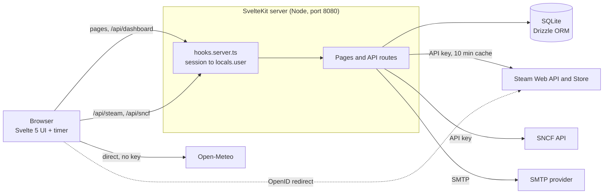

# 🚀 Dashboard
Requires Node.js 22.
<https://nodejs.org/>

Requires Docker.
<https://github.com/docker>

#

A customizable dashboard (Epitech project) that gathers information from several services in real time. Each user has an account, subscribes to services, and builds a personal dashboard from configurable widgets.

## 🎯 Purpose and main use cases

The goal is a **single, personal control panel** that replaces the browser's new-tab page: instead of opening several sites, the user opens one page where every widget shows live information from a different service.

| Use case | Who | What the user does | Widgets used | 
| ----- | ----- | ----- | ----- | 
| Daily commute | A student or worker taking the train | Subscribes to SNCF, adds the next departures between two stations and the traffic disruptions filtered on a line | `sncf.journeys`, `sncf.disruptions` | 
| Planning the week | Anyone | Adds the current temperature and the multi-day forecast for one or several cities (two instances of the same widget with different cities) | `weather.city_temperature`, `weather.city_forecast` | 
| Gaming | A Steam player | Links their Steam account, follows trailers of games on sale and the latest news of the games they play | `steam.trailer_loop`, `steam.owned_games_news` | 
| Several contexts | Someone with a home and a work city | Keeps several instances of the same widget with different configurations and refresh rates | all | 

## ✨ Features

* **Accounts**: registration with email confirmation (can be disabled with `ACCOUNT_NEED_VERIFICATION=false`), login/logout, hashed passwords (scrypt), server-side sessions in an HttpOnly cookie.

* **Services & subscriptions**: a service groups widgets. No service is enabled by default: the user subscribes from the **Services** page. Weather and SNCF need no external account (one click), Steam requires linking your Steam account first. Unsubscribing removes that service's widgets from the dashboard.

* **Dashboard**: add, reconfigure, move (drag by the header, or `Alt` + arrow keys) and delete widget instances. The layout is stored per user in the database. Two instances of the same widget can have different configurations.

* **Timer**: a single timer refreshes every widget at the refresh rate chosen for each instance. It pauses while the browser tab is hidden.

* **Responsive**: the dashboard is a single column on phones, and the widget configuration dialog becomes a full-width bottom sheet.

* `GET /about.json`: lists the services and widgets (generated from the widget registry).

## 🧩 Services and widgets

| Service | Widget | Needs a linked account | Main parameters | 
| ----- | ----- | ----- | ----- | 
| `weather` | `city_temperature` | no | city, units, display mode, details to show | 
| `weather` | `city_forecast` | no | city, number of days, unit, precipitation, maximum wind | 
| `steam` | `trailer_loop` | yes (subscription) | language, tags, excluded tags, sales only, max price | 
| `sncf` | `journeys` | no (needs `SNCF_API_KEY` on the server) | departure station, arrival station, number of journeys | 
| `sncf` | `disruptions` | no (needs `SNCF_API_KEY` on the server) | number of disruptions, severity, keyword filter | 
| `steam` | `owned_games_news` | yes | number of news, number of games, news per game, game selection (recent / most played), official announcements only, excerpt length | 

## 🐳 Run with Docker

```bash
cp .env.example .env        # then fill in STEAM_API_KEY and SNCF_API_KEY (see below)
docker-compose build
docker-compose up
```

* App: <http://localhost:8080> (`/about.json` is public).

* The SQLite database is stored in the `db-data` volume.

Create an account, then log in.

### 🎮 Steam setup

1. Create a Web API key at <https://steamcommunity.com/dev/apikey> and put it in `.env` as `STEAM_API_KEY`.

2. In **Services**, click *Link my account and subscribe* on Steam: you are redirected to Steam to sign in, then brought back and automatically subscribed.

3. For the `owned_games_news` widget to see your library, your Steam profile's **Game details** must be public.

### 🚄 SNCF setup

1. Request an API key at <https://numerique.sncf.com/startup/api/token-developpeur/> (you will receive it by email) and put it in `.env` as `SNCF_API_KEY`.


## 🏃‍♂️ Local Development

```bash
cp .env.example .env
npm install
npm run dev               # http://localhost:8080
```

or

```bash
docker compose up --build # http://localhost:8080
```

If `ACCOUNT_NEED_VERIFICATION=false`, accounts are activated immediately: no confirmation link is generated, no mail is sent and nothing is printed in the server console.
Otherwise (default), without `SMTP_HOST`, confirmation links are printed directly in the server console.

Useful scripts: `npm run check` (type checking), `npm run build`, `npm run db:generate` (generate a migration after editing `src/lib/server/db/schema.ts`). Migrations in `drizzle/` are applied automatically at startup.

## ⚙️ Configuration

| Variable | Purpose | Default | 
| ----- | ----- | ----- | 
| `ORIGIN` | Public URL of the app (**required behind plain HTTP**, otherwise form submissions are rejected) | `http://localhost:8080` in compose | 
| `STEAM_API_KEY` | Steam Web API key | — | 
| `SNCF_API_KEY` | SNCF API key, required by the SNCF widgets | — | 
| `DATABASE_PATH` | SQLite database file | `./data/dashboard.db` (`/data/dashboard.db` in Docker) | 
| `ACCOUNT_NEED_VERIFICATION` | `true`: a confirmation link is emailed at sign-up. `false`: no link is generated and the account is active immediately (existing unconfirmed accounts are activated at their next login) | `true` | 
| `SMTP_HOST`, `SMTP_PORT`, `SMTP_SECURE`, `SMTP_USER`, `SMTP_PASSWORD`, `MAIL_FROM` | Outgoing mail | links logged in the console if no `SMTP_HOST` | 

## 🎬 Demo walkthrough

A scripted path to show every feature of the application (about 5 minutes):

1. **Discovery endpoint**: open <http://localhost:8080/about.json> — services, widgets and their parameters (`string` / `integer`), generated from the same registry as the UI.

2. **Registration**: create an account. Open the link received (if `ACCOUNT_NEED_VERIFICATION` is `true`); then, log in. Try logging in before confirming: access is refused and a new link is sent.

3. **Services**: open the **Services** page. Subscribe to *Weather* and *SNCF* (one click, no account) and link *Steam* (OpenID redirect to Steam, then automatic subscription).

4. **Add a widget**: *Add a widget* → select a type → configure it → set the refresh rate → confirm.

5. **Same widget, two configurations**: add `city_temperature` twice with two different cities; both display different data at the same time.

6. **Reconfigure** a widget from its header, then **move** it (drag by the header, or `Alt` + arrow keys): the other widgets are not reloaded.

7. **Timer**: set a short refresh rate on a widget and watch its data refresh by itself; switch tabs and come back to see the timer pause and resume.

8. **Persistence**: reload the page or log in from another browser: the layout and every configuration are restored from the database.

9. **Delete** a widget, then **unsubscribe** from a service: its remaining widgets disappear from the dashboard.

10. **Responsive**: shrink the window (or open it on a phone) to see the single-column layout and the bottom-sheet dialog.

## 🏗️ System overview



* **Frontend** (SvelteKit + Svelte 5): the dashboard grid, the widget frame/host, the configuration dialog and a client store (`stores/dashboard.svelte.ts`) synchronised with the API. The **timer** (`core/timer.ts`) runs in the browser: each widget instance registers its refresh rate, and the timer calls the widget's `load()` when it is due.

* **Backend** (SvelteKit server routes on Node.js): `hooks.server.ts` turns the session cookie into `locals.user` and rejects unauthenticated `/api/*` calls. Routes handle auth, widget instance CRUD and ordering, subscriptions, the Steam OpenID link flow, and proxies for services that need a secret key (Steam, SNCF). The widget registry in `lib/core` is shared by the UI, the server-side parameter validation and `/about.json`.

* **Database** (SQLite through Drizzle ORM): one file, migrations versioned in `drizzle/` and applied at startup.

### 🗃️ Data model

| Table | Content | Deleted with the user | 
| ----- | ----- | ----- | 
| `users` | id, email, username, scrypt password hash, `email_verified_at`, creation date | — | 
| `sessions` | SHA-256 hash of the session token, expiry (30 days, renewed while used) | yes (`ON DELETE CASCADE`) | 
| `email_tokens` | SHA-256 hash of the confirmation token, expiry (24 h) | yes | 
| `subscriptions` | user + service name | yes | 
| `linked_accounts` | user + provider (`steam`) + provider account id (SteamID64) | yes | 
| `widget_instances` | user, service, widget, **params (JSON)**, refresh rate, position, size | yes | 

## 📁 Project Structure Overview

```text
src/
├── hooks.server.ts            # session → locals.user, protects /api/*
├── routes/
│   ├── (auth)/                # login, register, confirm
│   ├── (app)/                 # dashboard (/) and Services page — requires a session
│   ├── auth/steam/            # Steam OpenID link flow (start + callback)
│   ├── api/dashboard/         # widget instances CRUD + ordering
│   ├── api/steam/             # Steam endpoints used by the widgets
│   ├── api/sncf/              # SNCF endpoints used by the widgets (API key stays server-side)
│   └── about.json/
└── lib/
    ├── core/                  # widget registry, types, timer, services metadata, param validation
    ├── widgets/<service>/     # one folder per service
    ├── components/            # grid, widget frame/host, config dialog
    ├── stores/dashboard.svelte.ts   # client state, synced with the API
    └── server/                # db (Drizzle schema), auth, mail, config, subscriptions, steam
```

* **Stack**: SvelteKit (Svelte 5), SQLite via Drizzle ORM (`better-sqlite3`), Node adapter, Docker. See [Technology choices](#-technology-choices) for the reasons.

* **Adding a widget**: create a `WidgetDefinition` (params, `load`, component) in `src/lib/widgets/<service>/`, then add it to the `registerAllWidgets()` function. It will then appear in the dialog and in `/about.json`.

* **Security**: widget configuration is validated server-side against the widget's declared params. Every `/api/*` route requires a session and (for service routes) an active subscription. All queries are scoped to the logged-in user. Login is rate-limited.

## 📚 Libraries

| Library | Used for | Layer | 
| ----- | ----- | ----- | 
| `svelte` (5), `@sveltejs/kit` | UI components with runes, routing, server routes, hooks | frontend + backend | 
| `@sveltejs/adapter-node` | production build as a standalone Node server | backend | 
| `vite`, `@vitejs/plugin-basic-ssl` | dev server and bundler, HTTPS in development | tooling | 
| `better-sqlite3` | synchronous SQLite driver | database | 
| `drizzle-orm`, `drizzle-kit` | typed queries, schema, SQL migrations | database | 
| `nodemailer` | confirmation emails over SMTP | backend | 
| `cheerio` | parses the Steam store widget HTML on the server so it can be adapted | backend | 
| `dashjs` | plays the DASH trailer streams of the Steam trailer widget | frontend | 
| `typescript`, `svelte-check` | type checking (`npm run check`) | tooling | 
| `node:crypto` (built-in) | scrypt password hashing, random tokens, SHA-256 hashes | backend | 

## 🧠 Technology choices

Each layer was compared on the same criteria. Ratings are relative to this project: a small team, a few weeks, a real-time dashboard with widgets that call external APIs.

### 🖥️ Frontend

| Criterion | **SvelteKit (Svelte 5)** ✅ | React + Next.js | Vue 3 + Nuxt | 
| ----- | ----- | ----- | ----- | 
| Reactivity model | compiler-based runes, no virtual DOM, little boilerplate | virtual DOM, hooks and dependency arrays | proxy-based refs, close to Svelte | 
| Learning curve | low: plain HTML / CSS / JS in one file | medium: JSX, hooks rules, many patterns | low to medium | 
| Bundle size / performance | very small, fast updates | larger runtime | medium | 
| Full-stack in one project | yes: pages, API routes, server hooks | yes (App Router), more concepts | yes | 
| Ecosystem and libraries | smaller | largest | large | 
| Scoped CSS out of the box | yes | no (needs CSS modules or a library) | yes | 

### ⚙️ Backend

| Criterion | **Node.js (SvelteKit server routes)** ✅ | Python (FastAPI) | PHP (Laravel) | 
| ----- | ----- | ----- | ----- | 
| Language shared with the frontend | yes: TypeScript everywhere, shared types (`WidgetDefinition`, params) | no | no | 
| Handling many concurrent API calls | good: async I/O | good: async I/O | medium: one process per request | 
| Built-in auth / mail / ORM | none: assembled by hand (scrypt, Nodemailer, Drizzle) | none: assembled by hand | rich: auth, mail and ORM included | 
| Separate service to deploy | no: same process as the UI | yes | yes | 
| Setup and Docker image | one Node image | Python image + ASGI server | PHP-FPM + web server | 
| Fit for `/about.json` generated from the widget registry | direct: the registry is the same code the UI uses | needs a duplicated registry | needs a duplicated registry | 

### 🗄️ Database

| Criterion | **SQLite** ✅ | PostgreSQL | MongoDB | 
| ----- | ----- | ----- | ----- | 
| Setup | none: a single file | a server to run and configure | a server to run and configure | 
| Extra Docker service | none | yes | yes | 
| Data model fit | relational: users, sessions, subscriptions, linked accounts, widget instances | relational | documents: widget params are flexible JSON | 
| Integrity (foreign keys, unique constraints) | yes | yes | application-side | 
| Concurrent writes / scaling | one writer: enough for this load | excellent | excellent | 
| Migrations and typing | Drizzle ORM, versioned SQL in `drizzle/` | Drizzle ORM | Mongoose / manual | 

### 🎯 Why these choices

* **SvelteKit**: it gives the UI, the API routes and the server hooks in one project, so there is a single build and a single container. Svelte 5 runes keep widget components short, which matters when each service adds several widgets. React and Vue would work as well; Svelte was preferred for less boilerplate and smaller bundles.

* **Node.js**: the widget registry (`WidgetDefinition`, params, services) is written once in TypeScript and used by the dashboard UI, the configuration dialog, server-side validation and `/about.json`. A Python or PHP backend would force us to describe every widget twice. The price is that authentication, email and sessions are written by hand instead of coming from a framework; they are small (scrypt hashes, hashed session tokens, Nodemailer) and covered by rate limiting.

* **SQLite**: the data is small and relational, and the app is a single instance. SQLite removes a service from `docker-compose` and makes `docker-compose up` simple and reliable. The limit is a single writer: if the application had to run on several servers, PostgreSQL would be the next step. Drizzle keeps that migration contained: all database access lives in `src/lib/server` and a few route handlers, and the change is the driver, the schema dialect, and turning each synchronous `.get()` / `.run()` / `.all()` call into an `await` (see [Architecture trade-offs](#-architecture-trade-offs-and-alternatives)).

* **Docker**: a multi-stage build keeps the final image small, runs as a non-root user, and the database lives in a volume.

### 🧾 Synthesis: project needs and team knowledge

| Project need | Consequence for the stack | Choice | 
| ----- | ----- | ----- | 
| `docker-compose up` must work first time, on any machine | as few containers as possible | single Node container, SQLite file in a volume | 
| Services and widgets will keep being added (the grade depends on their number) | adding a widget must be cheap and must not touch the UI shell | widget registry in TypeScript, one `WidgetDefinition` per widget | 
| `/about.json` must always match what the app really offers | one source of truth | `/about.json` generated from the registry | 
| Some APIs need a secret key | keys can never reach the browser | server routes as proxies (Steam, SNCF) | 
| Small team, short deadline | stack the team can master quickly, little boilerplate | Svelte 5 + TypeScript end to end | 
| Responsive and accessible interface | scoped CSS, native HTML elements | Svelte components with plain CSS | 

> **Team context** — group of **[N students]**; shared prior experience: **[e.g. TypeScript/JavaScript, SQL, Docker, Git]**; new for the group: **[e.g. Svelte 5, Drizzle, OpenID]**. *(Fill in before the presentation.)* We chose one language for every layer so that any member can work on the UI, the API or the database code, and so that reviewing each other's work does not require learning a second stack. PostgreSQL, React or Laravel would have required either more setup or a language that only part of the group knows.

## 🧪 Proof of concept

The [`poc/`](./poc) folder contains the proof of concept built before the full application: one configurable widget (city, unit, refresh rate) that fetches real weather data from the Open-Meteo API through a SvelteKit server route, refreshes on a timer, and stores its configuration in SQLite. See [`poc/README.md`](./poc/README.md) to run it.

It validated the three layers of the chosen stack together before development: a SvelteKit server route acting as a proxy to a real external API, server-side validation of the widget's parameters, and persistence of the configuration with `better-sqlite3`. These are the same mechanisms the full application uses for every widget.

## ⚖️ Legal and ethical constraints (GDPR)

The application stores personal data of its users, so the GDPR (EU) applies. This is how we handle it.

### 📋 What we store

| Data | Purpose | Where | Retention | 
| ----- | ----- | ----- | ----- | 
| Email address | login, sending the confirmation link | `users` | until the account is deleted | 
| Username | display in the interface | `users` | until the account is deleted | 
| Password | authentication | `users`, **only as a scrypt hash**, never in clear | until the account is deleted | 
| Session token | keep the user logged in | cookie (token) and `sessions` (**SHA-256 hash only**) | 30 days, renewed while used | 
| Confirmation token | prove ownership of the email | `email_tokens` (hash only) | 24 hours | 
| SteamID64 (if linked) | read the user's own library and news | `linked_accounts` | until the account is deleted or unlinked | 
| Subscriptions and widget instances | restore the user's dashboard | `subscriptions`, `widget_instances` | until the account is deleted | 

Widget parameters (a city, a pair of stations, a game) can reveal habits such as where someone lives or commutes, so they are treated as personal data too and are only ever read for the logged-in user.

### 🔒 Principles applied

* **Minimisation**: no real name, birth date, phone number or address is requested, and no analytics or advertising tool is used.

* **Legal basis**: the account data is needed to provide the service the user asked for (contract). Linking Steam only happens after an explicit click on *Link my account*, and the user decides which services to subscribe to.

* **Security of processing**: scrypt password hashes, hashed tokens in the database, an HttpOnly + SameSite cookie (Secure over HTTPS), server-side validation of every input, rate limiting on login and registration, every query scoped to the current user. In production the app must be served over HTTPS (`ORIGIN`).

* **Cookies**: the only cookie is the session cookie, strictly necessary to log in, so no consent banner is needed.

* **Third parties** receive only what each widget needs:

| Recipient | What it receives | From where | 
| ----- | ----- | ----- | 
| Open-Meteo | city name and coordinates, **and the user's IP address** | directly from the user's browser | 
| SNCF API | station names | our server (the user's IP is not sent) | 
| Steam (API and store) | SteamID64 and game ids | our server | 
| Steam CDN | images and trailer streams, so **the user's IP address** | directly from the user's browser | 
| Steam (OpenID) | the user signs in on steamcommunity.com; we never see their Steam password | user's browser | 
| SMTP provider | email address and username | our server | 

* **Ethics**: no hidden tracking, no resale of data, no dark patterns (unsubscribing is as easy as subscribing and removes the related widgets), and we only read Steam data that the user chose to make public.

### 🧑‍⚖️ User rights and what is still missing

| Right | Status | 
| ----- | ----- | 
| Access, rectification, erasure, portability (Art. 15–20) | **not yet available as self-service in the application** | 
| Erasure by an administrator | possible today: deleting a row of `users` removes sessions, tokens, subscriptions, linked accounts and widget instances thanks to `ON DELETE CASCADE` | 
| Retention | no scheduled purge of expired sessions and tokens, no deletion of inactive accounts | 
| Breach notification (Art. 33, 72 h) | procedure to define if the app is ever hosted for real users | 

Planned improvements, each small because the data model already cascades: a *Delete my account* action, a JSON export of the user's data, a purge of expired rows at startup, and deletion of accounts that were never confirmed.

> With `ACCOUNT_NEED_VERIFICATION=false` the application stores an email address without proving that its owner typed it (accuracy principle, risk of someone registering with another person's address). This mode is meant for development and demonstrations; keep the default `true` when real users sign up.

## 💸 Risks and costs of our choices

### 🌐 External services

| Service | Cost today | Limit | What can go wrong | What we do about it | 
| ----- | ----- | ----- | ----- | ----- | 
| SNCF API | free developer plan | 150,000 requests/month, 5,000/day per token | quota exhausted: every SNCF widget shows an error for all users; a public or commercial use needs a paid plan on quote | minimum refresh per widget; **no server cache yet** (see below) | 
| Open-Meteo | free for non-commercial use | fewer than 10,000 calls/day, 5,000/hour, 600/minute | commercial use needs a paid plan; throttling when a network shares one IP | non-commercial school project; calls come from each user's browser | 
| Steam Web API | free key | per-key daily limit set by Steam's terms (about 100,000 calls/day, to verify) | key revoked if the terms are broken; one shared key for all users | responses cached 10 minutes by SteamID / game | 
| Steam store widget (`store.steampowered.com/widget/<appid>`) | free | none documented, **unofficial, no guarantee** | the HTML we parse with `cheerio` can change and silently break the trailer widget | cache per game, widget shows an error state, parsing isolated in one file | 
| SMTP | SMTP Provider (optional) | — | recommanded in production; mails need SPF/DKIM to avoid the spam folder | SMTP settings come from the environment | 

Limits and prices change: re-check each provider's page before any deployment.

### 🧰 Our own technical choices

* **Hand-written authentication**: no licence cost, full control and a good learning value, but every security fix and every future feature (password reset, 2FA) is our own maintenance.

* **SQLite in a Docker volume**: no database server to pay for or administrate, but the data lives in one file: losing the volume loses everything, and there is no automated backup yet.

* **Svelte 5**: smaller ecosystem than React, so fewer ready-made components, and a framework that moves quickly.

* **Single container**: cheapest to run (one small server is enough for this load), but no redundancy.

## 💥 How our choices could compromise the app or overload a third party

**The choice**: widgets refresh from the browser on a timer, and the SNCF key is **one key shared by all users**, used by routes that call the SNCF API on every refresh with no cache.

* A `journeys` refresh costs **3 SNCF calls** (two station lookups + the journey search), a `disruptions` refresh costs 1.

* At the default 5-minute refresh, one open `journeys` widget uses about **864 calls/day**. With the 5,000/day quota shared by everyone, **about 6 such widgets open all day exhaust it** for all users. At the minimum refresh (60 s) a single widget would use about 4,300 calls/day.

* A user can create up to 50 widget instances (`MAX_INSTANCES`), so one user, by mistake or on purpose, can use up the quota of the whole application, and SNCF could block the token.

* The same page opened in several tabs or devices multiplies the calls.

**What already limits the damage**: a minimum refresh rate per widget enforced on the server, the timer pausing while a tab is hidden, a 10-minute server cache for Steam, and a 50-widget cap per user.

**What we would add**: a shared server cache for SNCF keyed by stations and count (with a time-to-live at least equal to the widget's minimum refresh), a much longer cache for station-name lookups, and a per-user rate limit on `/api/sncf/*`. The number of SNCF calls would then depend on the number of *distinct* queries instead of the number of users.

**Other ways a choice could hurt us**:

* The rate limiter and the caches live in the memory of the Node process: a restart empties them (burst of Steam calls), and running two containers would give each its own counters.

* The weather widget calls Open-Meteo from the browser: no shared quota and no server load, but everyone on one network (for instance a school Wi-Fi during the keynote) shares the same IP and the same free limits.

* The Steam trailer widget depends on an unofficial page: a change on Steam's side breaks it without any change on ours.

* The timer runs in the browser, so nothing refreshes (and nothing can alert the user) when the page is closed.

## 🏛️ Architecture trade-offs and alternatives

Real requirements of the project often pull in opposite directions. For each pair below, this is what we chose, what it costs, and a concrete alternative that would only change a small part of the code.

| Conflicting requirements | Our choice | What it costs | Concrete alternative | What stays untouched | 
| ----- | ----- | ----- | ----- | ----- | 
| **Fresh data** (short refresh) vs **free API quotas** (SNCF 5,000 calls/day for all users) | per-widget refresh rate with a minimum, no server cache for SNCF | quota shared and easily exhausted | add a server cache for SNCF (see above) | only `src/routes/api/sncf/*` and one new cache helper change (3 files); registry, UI, timer and database are untouched | 
| **Privacy** (hide user IPs, never expose keys) vs **simplicity and zero server load** | Steam and SNCF go through our server; weather is called directly from the browser | the browser sends its IP to Open-Meteo; the two kinds of widget behave differently | proxy the weather calls through a server route, exactly as the PoC already does, combined with a cache | the weather widgets' `load()` functions and one new route (about 3 files); other services, UI and database untouched | 
| **Minimal infrastructure** (one container, one file) vs **scalability and resilience** | SQLite + in-memory caches in one Node process | one writer, one instance, no failover | PostgreSQL through the same Drizzle schema: new driver and schema dialect, one more Compose service, and each synchronous `.get()` / `.run()` / `.all()` becomes `await` | about 12 of the 65 source files (roughly a tenth of the code, all in `src/lib/server`, the dashboard/auth route handlers and `drizzle.config.ts`); widgets, components, registry and timer untouched | 
| **Control and learning** (own authentication) vs **security and development time** | scrypt, hashed sessions and tokens written by hand | we maintain security-critical code; no password reset or 2FA | delegate login to an OIDC provider (the subject allows it), which also removes password storage and email verification | `lib/server/auth.ts` and the `(auth)` routes; dashboard, widgets and database model stay | 

**Our own critique**: the choice that would be expensive to reverse is the frontend framework. Changing it would mean rewriting every component and the client store, far more than three quarters of the UI code. We accepted that because every other choice is isolated behind a boundary on purpose: the **widget registry** (a new service or widget touches one folder), the **`lib/server` modules** (database, auth, mail, Steam) and the **proxy routes**. The weak point of the design is state kept in process memory (caches, rate limits), which ties us to a single instance until it moves to the database or a shared store.

## ⚠️ Known limitations

* Steam accounts are linked with OpenID 2.0, not OAuth 2.0 (Steam does not provide OAuth 2.0).

* SNCF widgets show an error until `SNCF_API_KEY` is set.

* SNCF requests are not cached on the server, so the shared daily quota can be exhausted (see [above](#-how-our-choices-could-compromise-the-app-or-overload-a-third-party)).

* No self-service account deletion, data export or scheduled purge yet (see [GDPR](#️-legal-and-ethical-constraints-gdpr)).

* The weather widgets call Open-Meteo directly from the browser, and the Open-Meteo data is free for non-commercial use only; credit to Open-Meteo should be displayed.